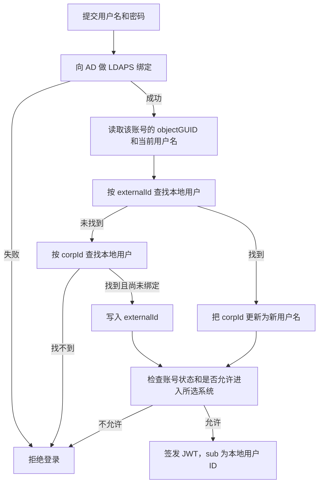

# AD 对接修改思路

本文说明三类相关改动：预约系统对接客户 Active Directory（微软企业身份目录）、系统只在公司内网部署，以及会议室门口屏的实时占用与 Quick Book。目录只负责验证身份；预订、额度、部门、角色仍以本地用户为准。

## 现在的登录

员工在登录页提交 `corpId` 和密码。后端在 `user` 表按 `corpId` 查找，用本地 `password` 核对，再按 `access_roles` 判断能否进入管理端，然后签发 JWT。令牌里的 `sub` 是本地用户数字 ID。后续接口都认这个 ID。

大屏播放程序本身仍然只负责全屏打开页面，不保存登录态。单会议室门口屏要增加占用展示和 Quick Book，见文末「会议室门口屏」。大厅合并屏、茶水屏、车位屏不在这次交互范围内。

## 改动原则

在现有登录前面加一层身份源。目录验证通过后，找到对应的本地用户，继续签发现在这种 JWT。守卫、角色判断、预订和额度接口保持不变。

本地用户必须已经存在，或由管理员事先绑定。第一次登录不自动建档，因为额度和预约角色是业务数据，目录里没有。

至少保留一个本地超级管理员。目录不可用时，仍可用本地账号进入系统。

## 先确认对方的目录类型

两种环境的登录体验不同，实施前需与客户 IT 确认。

| 客户环境 | 登录体验 | 后端做法 |
| --- | --- | --- |
| 院内 Active Directory（域控） | 保持工号 + 密码 | LDAPS 绑定。用用户提交的账号和密码向域控 bind，成功即密码正确 |
| Microsoft Entra ID（原 Azure AD）或 AD FS | 登录页改为跳转微软登录后再回来 | OIDC。后端校验授权码和 ID Token，不接收密码 |

院内网、工号即域账号时，优先 LDAPS。账号已在云端，或要求单点登录时，用 Entra ID 的 OIDC。下文流程按院内 AD、LDAPS 来写。OIDC 的本地用户对应方式相同，只是“绑定”换成校验 ID Token，稳定标识用对象 ID（`oid`）。

## 本地要保存什么

`user` 表继续保存登录名，并新增目录对象标识。AD 密码不入库。

| 字段 | 来源 | 用途 |
| --- | --- | --- |
| `corpId`（已有） | AD 的 `sAMAccountName` 或 UPN | 登录页输入的用户名，也用于界面和报表。用户在 AD 改名后，更新为新用户名 |
| `externalId`（新增） | AD 的 `objectGUID` | 目录里不变的对象标识。改用户名、改密码后用来认出同一个人 |
| `authSource`（新增） | 本系统 | `local` 或 `ad`。决定走本地密码还是目录验证 |
| `password`（已有，改为可空） | 仅本地账号 | `ad` 用户留空。个人资料中的改密入口对 AD 用户关闭，改密在医院统一入口完成 |

`corpId` 不是 `objectGUID`。两者是不同属性：一个会随改名变化，一个用来在改名后找回原用户。

`externalId` 是常规的账号关联字段。`objectGUID` 是账号编号，不是口令，也不能单独用来登录。不显示在页面上，不放入 JWT。同一条 `externalId` 只能对应一个本地用户。

姓名、邮箱可以在登录成功后从目录更新，仅作展示。角色、额度、启停仍以本系统为准。若客户要求“某个 AD 组才是管理员”，再单独做组到 `access_roles` 的映射，不放进第一期。

## 登录与校验流程

每次登录都用当时提交的用户名和密码向 AD 验证，不在本地缓存 AD 密码。

### 只改了密码

用户用原用户名和新密码登录。AD 绑定成功后，按 `corpId` 或已绑定的 `externalId` 找到原用户并签发 JWT。旧密码会在 AD 绑定失败。本地不用同步这次改密。

### 用户名和密码都改了

1. 用新用户名和新密码向 AD 绑定。
2. 绑定成功后读取 `objectGUID`。
3. 用 `objectGUID` 对应本地 `externalId`，找到原来的用户。
4. 把该用户的 `corpId` 更新为新用户名。
5. 用原来的本地用户 ID 签发 JWT。历史预订、额度和角色仍属于这个人。

旧用户名加新密码会绑定失败，必须使用新用户名。

若本地用户还没有 `externalId`，系统无法区分“改名”和“新账号”，拒绝自动建档，由管理员把目录账号重新绑到原用户。

### 管理员绑定

管理端为已有用户填写目录用户名并完成绑定：向 AD 查询该账号，核对后写入 `externalId`，`authSource` 设为 `ad`，清空本地密码。之后该用户只能用目录账号登录。

## 实施顺序

1. 与客户 IT 确认域控地址、LDAPS 证书、对应 `corpId` 的属性（`sAMAccountName` 或 UPN），以及目录中禁用的账号是否要同步为本地 `Inactive`。
2. 为 `user` 增加 `externalId`、`authSource`，并将 `password` 改为可空。
3. 登录改为：目录验证，找到本地用户，再签发现有 JWT。本地超级管理员仍走原来的密码校验。
4. 管理端提供绑定。AD 用户关闭本系统改密。
5. 联调：密码正确、密码错误、只改密码、同时改用户名、账号禁用、无本地档案、无管理端权限、目录不可达。
6. 按下一节部署到内网。能直连域控时，后端访问域控 LDAPS（636）；不能直连时，经单独的验证地址转发。服务账号只给读权限。

## 内网部署与 IP 分工

系统部署在公司内部服务器，不对公网开放：不做端口映射，不挂外网 DNS。沿用现有 Docker 与 Nginx。员工浏览器和门口播放器只访问业务 IP，例如 `http://10.1.1.10:3200`。前端已是同源访问 `/api`，页面和接口都走这一个地址。

PostgreSQL、Redis、Adminer 现在会映射到宿主机端口。内网服务器上取消这些映射，只留在 Docker 网络内给后端使用。办公网能访问的只保留 Nginx 的 3200，以及内网 HTTPS 的 3243。

服务器不能访问公网时，现在同步公众假期所用的 `1823.gov.hk` 会失败，需改为内网可访问的假期来源，或单独允许这条出站。邮件继续使用时，SMTP 指向内网或客户指定的邮件服务器。

### 业务 IP 和域控 IP 不是同一个

| 地址 | 例子 | 谁来访问 |
| --- | --- | --- |
| 业务 IP | `10.1.1.10` | 浏览器、门口屏、管理端。登录、预订、Quick Book、大屏刷新都发给它 |
| 域控 IP | `10.2.2.20`（LDAPS 636） | 负责验证的那一端。用户的电脑和门口屏不连接这个地址 |

登录页和门口 Quick Book 都把用户名、密码提交到 `10.1.1.10`。验证通过后，本地用户、额度和 JWT 仍由 `10.1.1.10` 处理。域控 IP 不写入前端。

若预约服务器被允许直接访问域控，后端配置 `LDAP_URL=ldaps://10.2.2.20:636`，由 `10.1.1.10` 自己去绑定。防火墙只允许这台服务器访问域控的 636，办公网和门口屏网段不能访问域控。

### 用另一个 IP 去访问域控

客户若要求预约服务器不直接连接域控，可以再设一个验证地址，例如 `10.3.3.30`。业务仍然只由 `10.1.1.10` 对外提供。

1. 浏览器或门口屏把用户名和密码发给 `10.1.1.10`。
2. `10.1.1.10` 把这一次验证转给 `10.3.3.30`。
3. `10.3.3.30` 向 `10.2.2.20` 的 636 端口做绑定，把是否成功和 `objectGUID` 交回 `10.1.1.10`。

防火墙只开两条：`10.1.1.10` 访问 `10.3.3.30`，`10.3.3.30` 访问 `10.2.2.20`。密码在两台服务器之间走内网加密通道，不保存。

`10.3.3.30` 若是另一台服务器，上面只放验证转发，不部署整套预约系统。若它只是 `10.1.1.10` 上的第二块网卡，后端连域控时指定从 `10.3.3.30` 出去即可，不必再拆一套服务。

### 不交付源代码

在己方机器上构建 Docker 镜像，只把镜像交到客户内网服务器。不交付 Git 仓库，也不把 `TKHO-backend`、`TKHO-frontend` 源码拷到对方机器。客户服务器需要已安装 Docker，不需要安装 Node.js。

现有 Dockerfile 已是分段构建。前端最终镜像只有 Nginx 和打包后的页面；后端最终镜像只有编译后的 `dist`、Prisma 表结构定义和运行依赖。对方执行的是载入镜像并启动，不是在服务器上构建。

1. 在能上网的构建机上，构建前端、后端、PostgreSQL、Redis 和 Nginx 镜像。客户内网通常拉不到 Docker Hub，这些基础镜像一并带上。
2. 用 `docker save` 打成 `.tar`。
3. 另交一套只写 `image:`、不含 `build:` 的 compose 文件、Nginx 配置、`.env` 模板和启动说明。数据库密码和 `JWT_SECRET` 由客户在现场填写。
4. 经 U 盘或客户允许的内网通道拷到业务服务器，执行 `docker load`，再 `docker compose up -d`。
5. 门口屏只安装现有 APK，并把地址改为业务 IP 上的单会议室页。不交付 `TKOH-display-player` 工程。

以后更新时，在己方重新构建镜像并交付新的 `.tar`。客户载入后重建前后端容器。数据库卷保留，不随镜像替换。

镜像中没有 TypeScript 和 Vue 源文件。后端 `dist` 仍是 JavaScript，浏览器也能看到打包后的页面脚本，Prisma 表结构也在后端镜像中。不交付仓库是当前这套系统合适的做法；若合同要求对方完全不能还原程序，需另定交付范围。

## 明确不动的部分

- JWT 的结构和 `sub` 的含义。
- 预订、额度、部门、角色的数据归属。
- 播放程序只打开页面，不在程序内登录。
- 大厅合并屏、茶水屏、车位屏维持只读。
- 本地超级管理员的登录通道。

## 会议室门口屏

每个会议室门口用现有单会议室页（`/VenueBooking/Display?displayType=single&venueId=...`）显示该房间。页面从只读的当日活动列表，改为实时显示当前是否被占用，并在空闲时提供 Quick Book。播放器仍全屏打开该地址，不预先登录成某一个员工。

Quick Book 创建的仍是正式预订，预订人必须落到本地用户。要走现有规则：目标时段没有冲突、在可订时间内、额度足够。从当前时间起订多长，实施前与客户确认，例如订到下一场开始，或固定一个时长。

### 是否要求输入用户名

在 Display 管理中增加开关，可按会议室单独设置。

| 开关 | 门口操作 | 预订记在谁名下 |
| --- | --- | --- |
| 关闭 | 看到空闲后直接 Quick Book | 该门口屏的公共账号。额度、部门和事后查询都对不上具体员工。仅当客户接受“先占座、不追到人”时使用 |
| 打开 | 先验证身份，通过后才下单 | 验证通过的那个本地用户，占用其额度 |

### 打开开关时如何验证

只输入用户名不能当作验证，旁人可以填别人的工号。门口屏是公用设备，也不能保持登录。

每次 Quick Book 单独验证一次，通过后立即下单并清空输入：

1. 输入用户名和密码。
2. 后端按与登录页相同的方式验证：AD 用户向目录绑定；本地超级管理员仍核对本地密码。
3. 用 `externalId` 或 `corpId` 找到本地用户。找不到则拒绝，不自动建档。
4. 用该用户执行 Quick Book。
5. 密码只用于这一次验证，不保存、不写入日志。门口屏不保留登录态，下一单重新输入。

门口周围容易看见输入。若现场有职员证读卡器，刷卡对应 `externalId` 可代替输入密码。也可以由屏上给出二维码，员工在自己的手机上登录并确认，密码不经过门口屏。这两种都仍然落到同一个本地用户。未选定前，默认按“用户名 + 密码、一次一单”实现。
