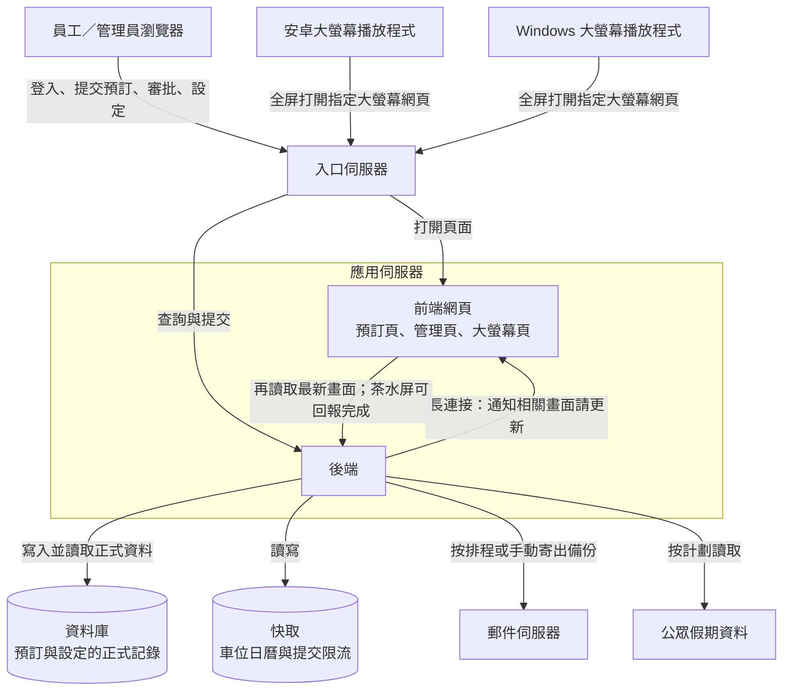

# 系統架構與訊息流轉說明

這份說明用來介紹本預訂系統的訊息是怎樣走的：員工在電腦上做的操作，如何經過網絡到達伺服器，再出現在現場大螢幕上。重點在各部分之間如何傳遞訊息，而不是逐項介紹功能。

## 鏈路架構圖

圖中由上至下是使用設備、入口、應用與資料。實線箭頭表示訊息方向。大螢幕播放程式只負責打開網頁；收到「請更新」之後，由網頁再向後端讀取最新內容。

---

## 一、系統由哪些部分組成

可以把整套系統想成四層。

**第一層：使用的人與設備**

- 員工和管理員使用辦公室電腦上的瀏覽器，登入後進行場地預訂、電動車位預訂、審批和系統設定。
- 現場大螢幕安裝專用播放程式。 Android 終端安裝 Android 版，Windows 電腦安裝 Windows 版。播放程式開機後全屏顯示指定畫面，不需要現場人員每天打開瀏覽器。

**第二層：網絡入口**

所有設備都連到同一台入口伺服器。入口負責把兩類請求分開：

- 打開頁面時，把網頁交給前端。
- 查詢或提交資料時，把請求交給後端。

日常使用時，使用者只需要記住一個網址。至於請求最後由哪一台應用伺服器處理，由入口統一安排。

**第三層：應用伺服器**

- 前端負責呈現畫面，包括預訂頁、管理頁，以及大螢幕頁。
- 後端負責核對身份、執行預訂規則，並把結果保存下來。

**第四層：資料**

- 資料庫保存所有正式資料，例如預訂、場地、使用者、車位和系統設定。畫面顯示的內容，都以資料庫為準。
- 另有一項快取服務，用來加快電動車位日曆的讀取，以及在短時間內限制過於頻繁的提交。大螢幕的即時刷新並不依賴這項快取。

---

## 二、大螢幕播放程式實際在做什麼

播放程式本身不保存預訂，也不直接連接資料庫。它的工作很單純：按照預先設定的網址，全屏打開伺服器上的大螢幕網頁，並保持這頁一直顯示。

設定裡只需要兩項：

- 要打開的完整網址，例如合併大螢幕、單個場地、茶水服務或電動車位。
- 每隔多少小時把頁面重新載入一次，用來長時間運行後釋放記憶體。建議設為十二至二十四小時。

播放程式會自動告訴網頁「這是專用播放器」，因此現場不會再彈出「請按一下進入全屏」的提示。

四類大螢幕對應四個獨立畫面：

| 現場畫面 | 網頁用途 |
|---|---|
| 單個場地 | 顯示該場地當日安排 |
| 合併大螢幕 | 多個場地集中顯示 |
| 茶水服務 | 顯示待處理的茶水安排，並可在現場標記完成 |
| 電動車位 | 顯示車位使用情況 |

不同場地可以各自安裝一台終端，每台只打開自己那一頁。內容更新都來自同一套伺服器，更換顯示內容時不需要重裝播放程式。

播放程式還會照看頁面是否仍在正常顯示。若頁面失去回應，或 Android 畫面元件異常結束，程式會自動重新打開頁面。因此建議關閉螢幕保護和休眠，並優先使用有線網絡。

---

## 三、一次預訂如何出現在大螢幕上

以員工新增或修改一場場地預訂為例，訊息按下面的順序流動。

1. 員工在瀏覽器中提交。請求經醫院或內網，先到達入口伺服器。
2. 入口把這次提交轉給後端。後端確認登入身份和預訂規則後，把結果寫入資料庫。
3. 寫入成功後，後端立刻向正在觀看相關大螢幕的網頁發出一則短通知。通知只說明「這個畫面需要更新」，以及更新的大致原因和時間，不會把整份預訂名單從這條通道送出。
4. 大螢幕網頁收到通知後，再向後端索取最新畫面資料。
5. 後端從資料庫讀出當前應顯示的內容，交還給網頁。網頁據此重畫螢幕。

 Android 或 Windows 播放程式全程只負責把這個網頁穩定地顯示出來。真正在收通知、取資料的，是網頁本身。

電動車位的變化走同一條路，只是通知會送到電動車位大螢幕，而不是場地大螢幕。場地資料有變動時，單場地螢幕、合併大螢幕和茶水螢幕會一起收到「請更新」的通知，因為這三塊畫面都依賴場地安排。

茶水螢幕是唯一會把現場操作送回伺服器的大螢幕。工作人員在螢幕上標記完成後，網頁把這次操作提交給後端並寫入資料庫，其他正在顯示茶水畫面的終端也會隨即更新。

---

## 四、大螢幕如何保持最新

每塊大螢幕同時使用兩種方式取得更新，互相補位。

**即時通知**

網頁與後端保持一條長連接。後端約每二十五秒送一次心跳，讓這條連接在經過網絡設備時不容易被中途切斷。一旦有相關預訂或設定變更，後端就從這條連接送出「請更新」。網頁收到後，通常在一秒內再去取最新資料。

**定時核對**

即使長連接暫時中斷，網頁仍會按固定間隔向伺服器核對一次最新資料。預設大約每分鐘一次，間隔可在十秒至五分鐘之間調整。這樣可以避免通知丟失時，螢幕長時間停在舊內容。

---

## 五、總結

現場大螢幕由 Android 或 Windows 播放程式全屏打開伺服器上的網頁，畫面內容由中央資料庫提供，播放程式本身不另行計算或保存預訂。

員工在電腦上完成預訂後，資料先存入資料庫。伺服器隨即通知相關大螢幕更新，大螢幕再讀取最新內容並顯示出來。若即時通知暫時中斷，螢幕仍會定時自動核對，避免長時間顯示過期資料。

更換顯示內容、調整預訂或切換伺服器版本時，不需要到每台大螢幕上重新安裝程式。終端保持聯網、播放程式保持打開，畫面即跟隨中央資料更新。
